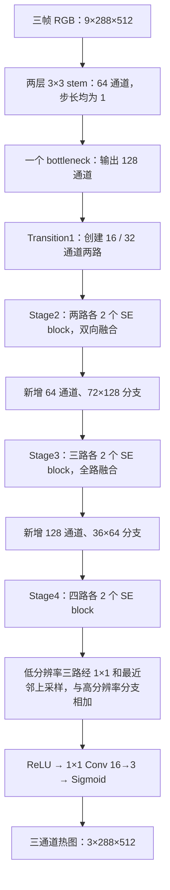

# ball.onnx 实际模型架构分析

分析日期：2026-10-13。对象：本次补充的 `pingpang/participant/weights/ball.onnx`。

## 1. 结论

**现在可以还原部署模型的内部结构：它是一个 HRNet 风格的定制多分辨率卷积网络，采用全分辨率 stem、16/32/64/128 通道并行分支、SE 通道注意力和三通道 sigmoid 热图头。**

这里的“HRNet 风格”是根据真实图拓扑及作者公开实现作出的架构归类，不代表已确认其官方类名、项目来源或具体发布版本。可描述为“基础分支宽度 16 的全分辨率 HRNet + SE 定制变体”；不能直接称作某个标准 HRNet-W16 或 TrackNet 版本。

关键事实：

- 输入 `float32 [B,9,288,512]`，输出 `float32 [B,3,288,512]`；仅 batch 是符号维。
- 59 个二维 Conv、18 个 SE 模块、1 个前置 bottleneck 残差块、18 个带 SE 的 basic 残差块。
- Stage2/3/4 各有 1 个多分辨率模块，分别含 2/3/4 条分支，每条分支均有 2 个 SE 残差块。
- ONNX 持有 **1,292,659 个浮点权重/偏置元素（约 1.293M）**，文件约 5.07 MiB。
- batch=1 下 Conv+MatMul 合计约 **27.106 GMAC / 54.212 GFLOP**（一次乘加按 2 FLOP）。这是静态计算，不是实测速度。
- 图内已包含最终 sigmoid；原始代码对此的注释已获模型证实。

证据附件：[完整图与统计 JSON](/home/radno/projects/pingpong/docs/ball_onnx_graph.json)、[逐层清单](/home/radno/projects/pingpong/docs/ball_onnx_layers.md)。下文节点索引均为该 JSON 中的 0 基序号。

## 2. 文件身份与接口

| 项目 | 实测读取值 |
| --- | --- |
| SHA256 | `a5a467f134ae7e2fc5679e395dca9af12b6dfcc65cee51e633c465beb0c61543` |
| 文件字节数 | 5,318,190 |
| Producer | `pytorch 2.10.0` |
| ONNX IR / opset | IR 8 / ai.onnx 17 |
| 图名称 | `main_graph` |
| 自定义 metadata | 空 |
| 输入 | `input: [batch_size,9,288,512]`，FLOAT |
| 输出 | `output: [batch_size,3,288,512]`，FLOAT |
| initializers | 154 个，全为 float32，全为有限数值，无未使用项 |
| initializer 存储字节数 | 5,170,636 |
| 图节点数 | 624，包含大量形状辅助节点，不能把它当作 624 个神经网络层 |

ONNX 本身支持符号 batch；当前 `Solution.prepare()` 把 TensorRT profile 固定为 batch=1。这两者并不矛盾。模型第一层直接是 Conv，因此 `/255`、RGB 标准化和三帧拼接仍由 Python 完成，未内嵌在模型图中。

Producer 只表明导出工具声明的版本，不能证明训练使用的 PyTorch 版本。它也不意味着评测环境需要升级至 PyTorch 2.10.0：当前部署加载 ONNX/TensorRT，实际兼容性需在目标环境验证。

## 3. 主干结构与特征尺寸

以下 shape 省略 batch，采用 `C×H×W`。

| 阶段 | 结构 | 输出特征 |
| --- | --- | --- |
| Stem | `Conv3×3 9→64, s1, p1 → ReLU → Conv3×3 64→64, s1, p1 → ReLU` | `64×288×512` |
| Layer1 | 1 个 bottleneck；主路 `64→32→32→128`，shortcut `64→128` | `128×288×512` |
| Transition1 | 从 Layer1 分别经 `3×3 128→16, s1` 和 `3×3 128→32, s2`，各带 ReLU | `16×288×512`、`32×144×256` |
| Stage2 | 2 条分支，每条 2 个 SE basic block；双向融合 | 同上两种尺寸 |
| Transition2 | 保留旧分支；最低分辨率经 `3×3 32→64, s2 → ReLU` | 新增 `64×72×128` |
| Stage3 | 3 条分支，每条 2 个 SE basic block；三路相互融合 | 三种尺寸保持 |
| Transition3 | 保留旧分支；最低分辨率经 `3×3 64→128, s2 → ReLU` | 新增 `128×36×64` |
| Stage4 | 4 条分支，每条 2 个 SE basic block；最终只形成最高分辨率融合输出 | `16×288×512` |
| Head | `Conv1×1 16→3, s1 → Sigmoid` | `3×288×512` |

所有 Conv 均为普通 `group=1` 二维卷积，dilation 为 1；共有 48 个 3×3 和 11 个 1×1。没有深度可分离卷积、ConvTranspose、3D 卷积、循环算子或 Softmax。36 个 MatMul 全部位于 SE 的两层通道映射中，没有 Q/K/V 自注意力路径。



**关键特征是高分辨率分支持续存在。** 两个 stem 卷积的 stride 都为 1，空间分辨率没有先降到 1/4。最低分辨率是输入的 1/8；输出也无需在最后进行统一的大倍数上采样。

## 4. 残差块与 SE 的精确形式

### 4.1 前置 bottleneck

节点 4–11 的主路为 `1×1 Conv 64→32 → ReLU → 3×3 Conv 32→32 → ReLU → 1×1 Conv 32→128`。shortcut 为 `1×1 Conv 64→128`，两路 Add 后 ReLU。所有 stride 为 1。虽然路径名包含 `downsample`，这里仅做通道投影，不降低空间分辨率。此块没有 SE。

### 4.2 18 个 SE basic block

每个分支块保持通道数 C 不变，图中可表达为：

```text
z = Conv3×3_C→C(ReLU(Conv3×3_C→C(x)))
s = GlobalAveragePool(z)                  # B×C×1×1
a = sigmoid(MatMul(ReLU(MatMul(s_flat, W1)), W2))
y = ReLU(x + z * reshape(a, B,C,1,1))
```

两个卷积均 stride=1、padding=1。SE 对卷积主路作通道重标定后才与 shortcut 相加；两层 MatMul 之间有 ReLU，末端有 sigmoid，无可见的 FC bias Add。

| 分支通道 C | W1 形状 | W2 形状 | SE 压缩比 | 全图此通道 SE 块数 |
| --- | --- | --- | --- | ---: |
| 16 | `[16,1]` | `[1,16]` | 16 | 6 |
| 32 | `[32,2]` | `[2,32]` | 16 | 6 |
| 64 | `[64,4]` | `[4,64]` | 16 | 4 |
| 128 | `[128,8]` | `[8,128]` | 16 | 2 |

其“全局池化→通道瓶颈→sigmoid→逐通道乘法”的连接方式符合 SE 的通道重标定设计；命名 `/se/` 也与之吻合。[SE 作者论文](https://arxiv.org/abs/1709.01507)

图中无 BatchNormalization 节点。大量带偏置的 Conv 与导出时融合 BN 的形式相容，但**不能据此断言训练网络没有 BN，或确定原始 BN 配置**。1.293M 是部署图权重/偏置统计，不承诺等于训练时可学习参数总量。

## 5. 分辨率融合如何实现

用 `b0,b1,b2,b3` 表示从高到低分辨率的分支。融合采用逐元素 **Add**，不是特征通道拼接。

- 低分辨率 → 高分辨率：先 `1×1 Conv` 匹配通道数，再最近邻上采样；Resize 参数为 `mode=nearest, coordinate_transformation_mode=asymmetric, nearest_mode=floor`。
- 高分辨率 → 低分辨率：使用一个或多个 `3×3 stride=2` 卷积；多步降采样时中间层有 ReLU，最后一层之后先融合再 ReLU。
- 每个目标分支将各来源相加，最后施加 ReLU。

Stage2 有 `b1→b0` 和 `b0→b1` 两个跨路变换；Stage3 有全部六个有向跨路变换；Stage4 仅输出 b0，其低分辨率来源分别上采样 2、4、8 倍。末端可写为：

```text
f = ReLU(b0 + up2(Conv1×1_32→16(b1))
            + up4(Conv1×1_64→16(b2))
            + up8(Conv1×1_128→16(b3)))
heatmaps = sigmoid(Conv1×1_16→3(f))
```

7 个 Resize 分布为 Stage2 1 个、Stage3 3 个、Stage4 3 个。图里虽有 36 个 Concat，但都用于 SE 的 shape 向量构造；没有用于主干特征融合的通道 Concat。

这与 HRNet 作者实现中的并行分支、双向尺度转换、求和融合和最终只输出高分辨率分支的模式一致。作者示例的 stem 为两次 stride=2，而当前文件为两次 stride=1，并另有 SE 和缩减后的阶段深度，因此归类为定制变体更准确。[HRNet 作者参考实现](https://github.com/leoxiaobin/deep-high-resolution-net.pytorch/blob/master/lib/models/pose_hrnet.py)

## 6. 参数与计算量

以下参数指 initializer 元素数；计算量只统计 batch=1 时 Conv、MatMul，不包括偏置相加、ReLU、sigmoid、融合 Add、SE 乘法、池化、Resize、形状处理和数据搬运。

| 阶段 | 权重/偏置元素 | GMAC |
| --- | ---: | ---: |
| Stem 两层 | 42,176 | 6.200230 |
| Layer1 | 23,872 | 3.472884 |
| Transition1 | 55,344 | 4.076863 |
| Stage2 | 51,760 | 2.906653 |
| Transition2 | 18,496 | 0.169869 |
| Stage3 | 233,712 | 4.633659 |
| Transition3 | 73,856 | 0.169869 |
| Stage4 | 793,392 | 5.468854 |
| Head | 51 | 0.007078 |
| 合计 | **1,292,659** | **27.105959** |

Conv 权重与偏置共 1,285,555 个元素；SE 的 MatMul 权重共 7,104 个元素。精确 MAC 为 **27,105,958,848**；按一次乘加等于 2 FLOP，为 **54,211,917,696 FLOP**。

Conv MAC 公式：`B × Cout × Hout × Wout × (Cin/group) × Kh × Kw`。MatMul 为 `M×K×N`。这些数由推断的实际输出尺寸和真实权重形状计算，非按模型名称查表。

参数少并不等于计算量低：第二个 stem 3×3 卷积单层就在全分辨率上做 64→64 映射，约 5.436 GMAC。单张 `128×288×512` float32 特征约占 72 MiB，说明运行显存不能只根据 5 MiB 模型大小估计；此数也不是整个模型的峰值显存。

## 7. 与现有推理代码的对应及剩余未知

| 先前结论 | 现在的证据 |
| --- | --- |
| 9 通道输入 | 已由 ONNX 确认；第一层权重 `[64,9,3,3]` 会直接混合三帧通道 |
| 三通道等尺寸热图 | 已由输出 shape 和末层权重 `[3,16,1,1]` 确认 |
| 模型内 sigmoid | 节点 623 `/Sigmoid` 直接产出 `output`，已确认 |
| 中间通道对应中间帧 | 仍来自 `ball_detector.py` 的接口语义；ONNX 没有训练标签元数据，不能独立验证该时间对应 |
| 不知道是否存在注意力 | 现在确认存在 18 个 SE 通道注意力模块 |
| 不知道内部是否为卷积网络 | 现在确认是多尺度二维卷积残差网络；图内无循环时序状态 |
| 落点识别方式 | 仍由 `Solution._emit()` 判断 y 极值；ONNX 没有输出触台事件分类结果 |

可恢复部署图的计算结构和数值权重，但仍不能确认原始源码类名、确切模型系列版本、预训练来源、训练数据、损失函数、热图标签生成方式、优化器、epoch、增强和 BN 训练配置。文件不含这些 metadata。最终三通道分别独立 sigmoid，也不能据此确定使用 BCE、MSE 或其他训练损失。

本次通过 ONNX `checker(full_check=True)`、batch=1 严格 shape inference 和权重有限性检查。**尚未执行真实视频推理、ONNX Runtime/TensorRT 数值对齐或精度/速度测试**，因此不报告新的 F1、FPS 或目标环境兼容性结论。

## 8. 复现与附件

新增分析代码：[inspect_ball_onnx.py](/home/radno/projects/pingpong/docs/inspect_ball_onnx.py)。它只读取权重，写出统计、完整节点连接和逐层清单，不运行网络，不修改权重或官方实现。

本次使用 `/tmp/pingpong-onnx-analysis` 隔离环境（ONNX 1.23.2、NumPy 2.4.6）执行静态分析；没有升级赛事运行环境的依赖。当前机器复核命令：

```bash
/tmp/pingpong-onnx-analysis/bin/python docs/inspect_ball_onnx.py
```

也可以在已有 onnx/numpy 的独立分析环境运行 `python docs/inspect_ball_onnx.py`；`--model` 和 `--output-dir` 可调整路径。输出文件是 [ball_onnx_graph.json](/home/radno/projects/pingpong/docs/ball_onnx_graph.json) 与 [ball_onnx_layers.md](/home/radno/projects/pingpong/docs/ball_onnx_layers.md)。若替换权重，以新生成的 SHA256 和统计为准。
