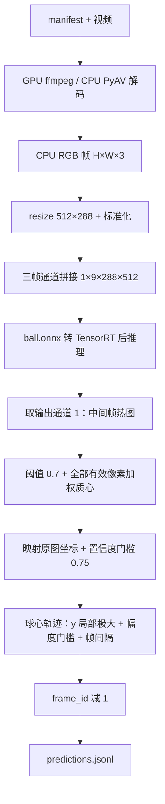

# Pingpong 官方参考实现：代码与模型架构分析

> **权重补充后的更新**：本篇保留为“尚未提供模型时”的代码分析快照。随后已获得并解析 `ball.onnx`，网络内部结构、输出 sigmoid 和参数量现已确认；“当前缺少权重、无法确定内部结构”等表述仅描述初次检查状态。最新结论见 [ball_model_architecture.md](/home/radno/projects/pingpong/docs/ball_model_architecture.md)：HRNet 风格的全分辨率多分支网络，带 18 个 SE 模块，部署图约 1.293M 权重/偏置元素。本篇的 Python 推理链与落点后处理分析仍适用。

分析日期：2026-10-13。代码版本：`282465ae4ce551756eb7551f21bfbbe0704b9d93`。
范围：当前工作区的乒乓球任务 `pingpang/`（目录实际拼写如此）、联合入口、README 和 `TaskDescription.md`。后者为工作区未跟踪文件，作为赛题说明使用，不视为该 Git 提交内容。篮球代码仅用于区分两个任务，不将其模型信息套用到乒乓球。

## 1. 能否得出官方模型架构？

**能还原系统方案、模型输入输出约定及全部可见后处理，但不能从当前仓库唯一还原神经网络内部架构。**

当前实现是：**三帧 RGB 按通道拼接，送入外部 ONNX 球位置热图模型；取中间帧热图求球心；再以球心纵坐标局部极大值判断触台事件。** 落点判断由 Python 规则完成，没有可见的落点分类网络。

仓库没有 `pingpang/participant/weights/ball.onnx`，也没有网络定义、训练代码、导出脚本或训练配置。因而不能确认具体模型名称/版本、骨干、编码解码结构、卷积层数、跳连、注意力、参数量、FLOPs、损失函数和训练超参数。仅凭“三帧输入、三张热图”不能断言它是某一版 TrackNet、U-Net 或其他命名架构；这里不作这种归属判断。

证据分三类：**已证实**指可执行源码直接表达的行为；**接口约定**指注释/消费方式表达的模型预期，但缺少模型文件核实；**未知**指现有材料不足。

| 信息 | 当前可得结论 | 证据等级与位置 |
| --- | --- | --- |
| 系统组成 | 球定位模型 + 确定性落点规则 | 已证实；`solution.py:63–92` |
| 模型载体 | 代码要求加载 `weights/ball.onnx` | 已证实；`solution.py:34–35`；文件当前缺失 |
| 输入名字与形状 | `input`，固定 `(1,9,288,512)`，NCHW | 已证实为调用要求；`solution.py:41–43` |
| 输入时序 | 旧、中、新三帧，各 3 个 RGB 通道，沿 C 维连接 | 已证实；`ball_detector.py:49–58` |
| 输入数据 | CPU 预处理产生 float32；RGB `/255` 后按 ImageNet mean/std 标准化 | 已证实；`ball_detector.py:24–26,42–47` |
| 输出 | 预期 `(1,3,288,512)`，各通道分别对应三个输入时刻 | 接口约定；`ball_detector.py:28,58`；代码实际只取 `[0,1]`，没有断言完整 shape |
| 激活函数 | 消费端预期已含 sigmoid，Python 不再施加 sigmoid | 注释约定；`ball_detector.py:58`；不能据此证明 ONNX 中确有 `Sigmoid` 节点 |
| 输出坐标 | 在热图上求一个球心，按原始宽高比例放大 | 已证实；`ball_detector.py:59–70` |
| 模型时序状态 | 可见 Python 状态为三帧缓存；未见隐藏状态输入/输出 | 已证实为封装行为；不能据此排除 ONNX 内部的任何特定算子 |
| 推理后端 | TensorRT；支持时请求 FP16 优化；输入输出缓冲使用 float32 | 已证实；`core/trt.py:51–81,114–129`；不等于已测得全模型纯 FP16 |
| 训练与网络内部 | 未提供 | 未知；当前文件搜索未发现相关定义或模型文件 |

主要源码：[Solution](/home/radno/projects/pingpong/pingpang/participant/solution.py:23)、[BallDetector](/home/radno/projects/pingpong/pingpang/participant/ball_detector.py:24)、[TensorRT 封装](/home/radno/projects/pingpong/pingpang/core/trt.py:51)。

## 2. 工程结构与执行链

| 文件/模块 | 职责 |
| --- | --- |
| `run_all.sh` | 容器内依次执行乒乓球、篮球，先验证框架完整性 |
| `pingpang/run.py` | 加载 manifest、动态导入 Solution、运行 Runner、校验 JSONL、统计输出目录大小 |
| `core/dataset.py` | 解析视频清单，优先输入目录 manifest，随后尝试公开数据目录 |
| `core/decoder.py` | ffmpeg CUDA 或 PyAV CPU 解码，统一产出 RGB uint8，检查总帧数 |
| `core/runner.py` | `prepare → [reset → process_frame × N → finish_video] × V`，记录耗时和逐视频失败 |
| `participant/solution.py` | 加载模型，维护球心轨迹，输出落点 |
| `participant/ball_detector.py` | 预处理、三帧缓存、调用注入的推理函数、热图解码 |
| `core/trt.py` | ONNX 转 TensorRT、engine 缓存、GPU 推理与数据搬运 |
| `core/writer.py` / `validate.py` | 添加 video_id 并写文件；检查字段、范围和近邻重复 |



这张图表示已公开的系统流程，`ball.onnx` 内部仍是未展开的黑箱。虽然解码模式名是 `gpu`，解码器经 rawvideo 管道交付 CPU NumPy 数组，因此该流程不是全程 GPU 零拷贝流水线。

## 3. 球位置模型的输入与解码

### 3.1 预处理与三帧窗口

每一帧执行：

1. `cv2.resize(frame_rgb, (512,288), INTER_LINEAR)`，直接缩放，无 letterbox、裁剪或 ROI。
2. 转 float32 后除以 255。
3. RGB 通道分别减 `[0.485,0.456,0.406]`，除以 `[0.229,0.224,0.225]`。
4. HWC 转 CHW，三帧按时间顺序连接，再增加 batch 维。

处理输入帧 `t` 时，正常窗口为 `[t-2,t-1,t]`；使用第 1 号输出通道，语义是 `t-1` 的球位置。9 通道是三个 RGB 图像的串接，**没有显式的 `(batch,time,channel,height,width)` 时间维**。时序融合发生在模型输入边界，内部如何融合则未知。标准化常量也不能证明网络采用 ImageNet 预训练骨干。

每视频开始缓存预填两张经过同样标准化的黑图，而非全零浮点张量；黑图三通道约为 `[-2.118,-2.036,-1.804]`。因此首个窗口为 `[黑,黑,帧0]`，第二个为 `[黑,帧0,帧1]`。代码没有显式丢弃第一个窗口结果；若模型在黑图对应的中间通道产生高响应，仍可能进入轨迹。`prepare()` 的黑图 warmup 状态会在随后 `reset()` 时清空。

### 3.2 热图解码公式

令 `h = output[0,1]`，`M = {(u,v) | h(v,u) > 0.7}`。若 M 为空则无检测，否则：

```text
cx = sum(u * h(v,u) for (u,v) in M) / sum(h(v,u) for (u,v) in M)
cy = sum(v * h(v,u) for (u,v) in M) / sum(h(v,u) for (u,v) in M)
x  = cx * 原图宽度 / 512
y  = cy * 原图高度 / 288
conf = max(h(v,u) for (u,v) in M)
```

这里的 `conf` 是所选热图最高响应，不是单独训练或输出的落点置信度；只有 `conf >= 0.75` 的检测才写入轨迹。坐标是热图响应质心，不是球 bbox，也没有额外估计球的下缘接触点。

**注释中的 “blob” 不应理解为连通域筛选。** 实际只有 `np.nonzero(mask)`，没有连通域分析、最大区域选择或 NMS。如果两个不相连区域都超过阈值，二者都会参与质心计算，结果可能落在两区域之间。例如同一行上 x=100 和 x=300 两个等权响应，输出 x=200；并不选取其中一个候选球。

1920×1080 输入的 x/y 缩放系数均为 3.75，1280×720 时均为 2.5。原始分辨率较低时球在输入中的尺度也会受影响；输出像素门槛没有按分辨率统一归一化。

## 4. 落点判定：规则、时间对齐与边界

代码保存通过置信门槛的 `(当前输入帧号, x, y, conf)`。对轨迹索引 j 的判定为：

```text
fid[j] - last_emit >= 10
y[j] > y[j-1] 且 y[j] >= y[j+1]
y[j] - y[j-1] >= 2.0 原图像素
y[j] - y[j+1] >= 1.0 原图像素
```

满足后返回 `Landing(frame_id=max(0,fid[j]-1), x=x[j], y=y[j])`，并把 `last_emit` 更新为未减 1 的 fid。图像 y 向下为正，所以这是“向下运动后转向上”的局部极大。落点输出不包含 `conf`。

| 参数 | 默认值 | 实际作用 |
| --- | --- | --- |
| `SCORE_TH` | 0.7 | 热图像素严格大于此值才参与质心 |
| `CONF_TH` | 0.75 | 热图最大响应至少达到此值才保留轨迹点 |
| `FALL_AMP` | 2.0 px | 与前一保留轨迹点的 y 差 |
| `RISE_AMP` | 1.0 px | 与后一保留轨迹点的 y 差 |
| `MIN_GAP` | 10 帧 | 已输出落点与新候选的最小帧间隔；25 fps 下为 0.4 s |
| `need_future` | 正常 2，结束 1 | 要求后续保留轨迹点数量；不是后续连续视频帧数 |

需要准确理解的行为：

- **正常输出约滞后 3 帧。** 无漏检时，真实位置在 k，输入 k+1 才得到该位置；再等两个轨迹点，到输入 k+3 输出帧号 k。25 fps 下是 120 ms 的帧时序等待，不包括计算耗时。漏检会增加等待。
- **第二个未来点只用于等待，不参与运动形状判断。** `_emit(2)` 确保 `j+2` 存在，但只比较 `j-1,j,j+1`。不能称为五点拟合或两帧反弹确认。
- **不检查轨迹连续性。** 丢失中间检测后，即使前后轨迹点相隔很多帧，也仍直接比较 y，没有插值、速度除以 Δt 或最大断点间隔。
- **结束处理不是模型窗口补齐。** `finish_video()` 只重扫已有轨迹，不补黑帧、不复制末帧、不重新推理。N 帧视频最后一次模型输出对应 N-2；正常从中间通道得到的 N-1 位置缺失。连续有效检测时，finish 最后最多判定到真实帧 N-3，因为峰值后仍须一个轨迹点。
- **首末轨迹点本身不能成为候选峰值。** 循环从 j=1 开始；末点没有未来邻点。尾处理并不能保证覆盖末尾所有落点。
- **每帧重新遍历全部历史轨迹。** 单次扫描 O(m)，整段 T 帧在检测密集时累计 O(T²)，存储 O(T)。`MIN_GAP` 会跳过旧峰，但并未剪掉历史列表。

相关源码：[落点规则与帧号补偿](/home/radno/projects/pingpong/pingpang/participant/solution.py:63)。

## 5. TensorRT 部署能透露什么

`prepare()` 要求模型存在，随后 `load_or_build()` 在 `<output>/trt_cache/<TRT版本>/<GPU名称>/<模型名>-<ONNX MD5前12位>.engine` 加载或构建 engine。构建使用 EXPLICIT_BATCH，优化 profile 的 min/opt/max 均为 `(1,9,288,512)`，workspace 上限默认 1 GiB。若硬件支持 fast FP16 则设置 FP16 标志，没有 INT8 校准逻辑。

运行时封装要求一个输入，选择第一个输出 binding；它面向单输出模型，没有完整的多输出支持。每次推理从 NumPy 搬到 CUDA、分配 float32 输出、在专用 CUDA stream 执行、同步，再将完整输出拷回 CPU。torch 用于设备缓冲和 stream；代码没有定义 `torch.nn.Module` 网络。

由此可以证实部署形态，但不能推出具体网络层结构、实际逐层精度或实测性能。尤其是：

- 缓冲 dtype 写死为 float32，未按 engine binding dtype 自动适配；换模型时须核对接口。
- 没有视频批处理、多 GPU 调度、跨视频并行或多窗口热图投票。
- 乒乓球 `prepare()` 没有 ONNX Runtime 回退。`--decoder cpu` 只更换解码器，不会使模型推理变成 CPU 模式。
- 构建时间和 warmup 属于 `prepare_sec`；Runner 的 `infer_sec = total_wall - prepare_sec` 包括视频解码、算法、写出和其他循环开销，并非纯网络耗时。engine 构建仍计入总耗时。
- 缓存放在输出目录，`run.py` 遍历输出目录时会将其计入 1 GiB 额度。

相关源码：[engine 构建](/home/radno/projects/pingpong/pingpang/core/trt.py:51)、[推理与搬运](/home/radno/projects/pingpong/pingpang/core/trt.py:114)、[计时](/home/radno/projects/pingpong/pingpang/core/runner.py:51)。

## 6. 算法能力边界与分数口径

可见实现没有球桌检测、桌面区域限制、相机标定、单应映射、3D 轨迹恢复、回合切分或基于视角的参数分支。`VideoMeta.angle` 进入框架日志，但官方 Solution 没有用它调整规则。球员/球桌训练标注是否曾用于训练 `ball.onnx` 无法确定，不能因当前 Python 没使用它们就否定训练侧使用的可能性。

系统直接把二维球心轨迹极值当作触台事件，无法从规则本身保证区分触台、挥拍改变方向、误检或镜头运动。全局质心、多峰混合、漏检后连接、固定原图像素门槛和 10 帧抑制都可能影响结果；这是从规则推导的风险，未通过本地真实视频定量验证。

`TaskDescription.md:63` 声明公开验证集 F1=0.604，0°/45°/90° 分别为 0.408/0.644/0.697。这些是**文档报告值，不是本次复现实测值**。同文档给出 ±1 帧、50 px、一对一匹配和分视角 F1 的评分口径；当前 `validate.py` 只检验输出结构、数值范围与近邻重复，不计算这些 F1 指标。三个分视角值的简单均值约 0.583，不能直接把 0.604 当作它们的平均；该总值的具体汇总方式需完整评分程序或原始 TP/FP/FN 确认。

来源：[赛题与基线说明](/home/radno/projects/pingpong/TaskDescription.md:44)、[输出校验](/home/radno/projects/pingpong/pingpang/validate.py:29)。

## 7. 当前工作区可复现程度

截至本次检查：

| 项目 | 状态 |
| --- | --- |
| 官方参考 Python 推理及规则代码 | 存在 |
| `ball.onnx` / `.pt` / `.pth` / `.engine` | 当前仓库文件搜索未发现 |
| `pingpang/public_data/` | 不存在 |
| `data/` | 空目录 |
| 训练脚本/网络类/导出配置 | 未发现 |
| 当前 shell 的 `python3` 依赖探测 | `numpy`、`cv2`、`onnx`、`torch`、`tensorrt` 均不可发现；不代表另一个容器环境的状态 |
| 乒乓球框架完整性 | `python3 pingpang/integrity.py --verify` 通过 |
| 规则语义验证 | 7/7 通过，详见下述附件 |

根目录 `.gitignore` 忽略 ONNX、PyTorch 权重、engine、视频和公开数据目录，解释了这些资源可能独立交付，但不能证明任何具体缺失模型的内容。README 的“开箱自测”描述不适用于缺少模型和数据的当前 checkout。

因此本次没有运行 TensorRT、真实视频推理、F1 评分或 FPS 测试，也没有声称恢复了模型参数或内部网络结构。

额外静态发现：若先补齐合法 manifest、但模型仍缺失，`prepare()` 会失败；在干净输出目录中 `run.py:72–77` 的“预测文件不存在”分支缺少 `n_warnings`，随后日志读取会引发 `KeyError`，可能掩盖前面的失败原因。此处仅记录，没有修改受保护框架。[对应源码](/home/radno/projects/pingpong/pingpang/run.py:71)

## 8. 补齐哪些材料后能进一步确定架构

最有价值的是与这份参考代码配套的 `ball.onnx`。获得后可按以下顺序继续取证：

1. 记录文件大小和 SHA256，读取 ONNX producer、opset、metadata、真实输入输出名称/shape/dtype，并核对当前封装要求。
2. 检查图中 Conv、池化、Resize/ConvTranspose、Concat/Add、归一化与激活节点及连接关系；看是否具有编码器/解码器、跳连、多尺度路径。节点名只能辅助判断，不能单凭名称确认模型来源。
3. 确认输出是否包含 sigmoid，验证三通道时间语义及通道顺序。输入输出 shape 本身不能证明每通道对应哪个时刻，仍需导出定义或有标注序列验证。
4. 统计 initializer 元素数及字节数，区分权重与常量；ONNX 可能已融合归一化或变换权重，这些数量不必等于原始训练模型参数量。结合算子、shape 和约定估算 FLOPs。
5. 将 ONNX 与 TensorRT 在相同输入上的热图和落点结果对齐，随后使用配套验证集和正式评分程序检查 F1、帧对齐与速度。

要恢复“训练时官方实现”，还需要网络源码或配置、训练入口、数据处理和标注生成规则、损失函数、训练参数及导出命令。ONNX 即使完整，也通常不能唯一恢复原始源码类名、训练过程和数据来源。

在补齐材料前，可复现的是输入接口、部署封装和后处理；若另行构建同接口模型，应称为兼容实现，而非已还原官方网络。

## 9. 本次验证附件

[verify_baseline_semantics.py](/home/radno/projects/pingpong/docs/verify_baseline_semantics.py) 使用标准库 AST 从现有 `Solution` 提取原始 `_emit` 方法及阈值常量，配合最小 Landing 容器执行。没有重写规则，也没有导入或伪造神经网络推理。

复核命令（项目根目录执行）：

```bash
python3 docs/verify_baseline_semantics.py
python3 pingpang/integrity.py --verify
```

保存结果：[baseline_semantics_results.json](/home/radno/projects/pingpong/docs/baseline_semantics_results.json)。7 个用例分别验证正常等待两个未来点、尾部只需一个未来点、第二未来点的 y 不参与判断、跨帧缺口不被拒绝、9 帧间隔被抑制、10 帧间隔可通过，以及末个轨迹点无法独立成为峰值。它们验证的是源码语义，不能替代端到端精度或性能评测。
