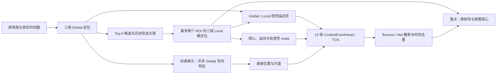

# Quick intro：乒乓球落点检测

更新：2026-10-20。面向刚加入的组员，建议先读本文，再按[训练指南](training_guide.md)操作。

## 1. 我们要做什么，目前做到哪里

输入一段乒乓球视频，输出每次触台的**原视频帧号和原图坐标**。我们把问题拆成球定位、连续轨迹和时序事件识别，再用完整视频落点成绩验收。

当前可继续开发的研究基线是 **三帧 Global/Local 球定位 + 历史轨迹关联 + 桌框几何 + 13 帧 TCN**。它已完成内部完整视频验证、三种子复核及外部检查。后续确定的方向是独立桌框特征分支和分阶段训练，尚未完成新分支的实现、训练。

研究模型还没有接入赛事提交入口。`pingpang/participant/solution.py` 当前运行的是 YOLO 球定位与落点规则；直接运行比赛脚本得到的是这条旧路径的结果。

## 2. 过去做了哪些实验

| 阶段 | 做法与观察 | 留下的结论 |
| --- | --- | --- |
| 检测与规则基线 | 官方热图定位、YOLO 球检测、轨迹极值落点规则 | 建立定位与落点分开评估的流程；球找得准不等于触台判得准 |
| 自建定位器 | 单帧 Residual FPN 扩展为三帧输入，先 Global，再 Local | fixed3 成为当前定位前端；内部 50px 球心 F1：Global 85.48%，Global+Local 86.06% |
| 冻结事件头 | 使用 OpenTTGames 的 Bounce/Net 监督训练 TCN | 稀疏锚点分类与真实完整视频落点存在差距，需要 PP 连续事件监督 |
| PP 补标与 A/B/C/D 对照 | 接入人工触台标注；比较独立解码/轨迹关联 × TCN/Transformer | seed42 内部落点宏 F1：A 72.44%，B 77.96%；关联路径值得保留 |
| 桌框、AR、事件头对照 | 加桌框几何，训练 AR 选择器，公平比较 TCN/Transformer | TCN+box+时间编码成为主基线；当前 AR 配方退化，保留负结果，不采用 |
| 轻量优化 | 采样调整、桌框窗口 EMA、AR null 修复 | EMA 仅少 1 个 FP；困难背景采样下降，AR 未通过门槛，不扩展训练 |

已停止、无完整验证的随机联合训练，以及重复 smoke/失败启动记录，已移入本机归档。完整的负结果仍保留，避免重复走已验证的弯路。[整理清单](workspace_cleanup_20261020.md)记录了范围。

当前主要版本如下；内部指标均为同一 PP 验证集的三视角落点宏 F1。

| 版本 | seed42 | 三种子均值 ± 标准差 | 本地完整视频 FPS | 用途 |
| --- | ---: | ---: | ---: | --- |
| [baseline_B](../result/baseline_B/README.md) | 77.96% | 76.41% ± 1.11pp | 79.75 | 轨迹关联基线 |
| [TCN + 桌框 + 时间编码](../result/tcn_frames_lr0.0003_d0.1/README.md) | **79.56%** | **78.77% ± 2.30pp** | 77.53 | **后续开发与复现实验的主基线** |
| [TCN + 桌框 EMA](../result/20261017-112200_tcn_fast_refine/README.md) | 79.69% | 仅 seed42 | 86.88 | 单种子候选，保留原 TCN 回退 |
| [Transformer 对照](../result/transformer_frames_lr0.0001_d0.1/README.md) | 75.03% | 75.72% ± 1.80pp | 79.83 | 完整对照 |

TCN 主基线及 EMA 的 PP public 落点宏 F1 均为 **70.97%**，OpenTTGames test 稀疏锚点分类宏 F1 均为 **83.53%**。两种任务的 F1 不直接比较。EMA 没有观察到外部精度收益，不能凭内部 0.13pp 宣布稳定提升。

上述速度来自 RTX 5070 Ti、PyTorch AMP 的历史实测，包含解码、前端、事件和 JSON 序列化，不含初始化与磁盘写入；各轮测速不作速度增益归因，也不代表比赛 4090 的实测。

## 3. 当前模型长什么样



- **定位器**：两套独立参数的 Residual FPN，非官方 TTNet 原网络。三帧共享逐帧编码器，在四个尺度做有序时序融合，输入缺失 mask 与真实时间差。Global 输入 512×288；Local 输入 256×256，原图裁剪边长按 `256 × 原图高度 / 1080` 缩放。各输出球热图和 128 维视觉描述符。
- **轨迹**：使用历史信息的规则关联，Global Top-5、最多 8 条假设、6 步历史，处理缺失和重捕获；轨迹预测与 Global 提议可产生两个 Local ROI。轨迹预测点不冒充有效观测，GT 不参与验证搜索。
- **当前桌框**：`TableHead` 对 Global 空间特征做 4×4 pooling，再用 MLP 回归单个 bbox。它尚不是独立桌面视觉编码器。验证平均 IoU 约 38.75%，标签与薄框泛化存在问题；旧首页“桌框质量不是瓶颈”的判断已撤回。
- **事件头**：`ContextEventHead` 将 256 维视觉投影到 96 维、9 维运动投影到 32 维、9 维场景几何投影到 32 维，融合成 128 维并加真实时间编码。三层 TCN dilation 为 1/2/3，输出中心帧 Bounce/Net 两个 logit。`box` 模式使用桌框位置与尺度，不启用球相对桌框坐标。
- **时序范围**：事件窗口是原生帧号的 13 帧；中心预测需未来 6 帧，定位器另需 1 帧。当前执行器是离线完整视频，吞吐 FPS 与在线等待时间分别看。EMA 候选在窗口内对桌框做时间平滑，tau=0.15 秒。

## 4. 代码从哪里看、从哪里改

```text
configs/
  experiments/             本地完整方案，先看 event_tcn_reference.json
  components/              定位、轨迹、事件头与训练默认值
  datasets/                数据入口与固定 split_id
  server/                  迁移配置；ball_compact 关闭磁盘图像缓存
ttnet/src/
  cli.py, configuration.py 配置展开、训练/评估/导出统一入口
  models/localizer.py      Residual FPN 球定位器
  models/event.py          EventHead、ContextEventHead、Transformer
  tracking/               候选、规则关联、AR 与推理运行时
  scene/                  旧桌框、几何、场景消融和结果报告
  events/                 事件数据、特征缓存、训练、连续评分与在线 joint 路径
  training/               球定位数据集、训练与输入缓存
  data_tools/             数据转换、FrameStore、原视频读取、校验
  evaluation/, tests/     球定位评估与回归检查
scripts/                   原数据准备、迁移打包、历史 YOLO 工具
experiments/               固定划分、保留记录、可重建索引
result/                    五套完整版本的结果与错误视频入口
out/                       实际训练日志、权重、缓存评估与启动记录
data/                      原视频、标签、数据描述和本机帧/特征缓存
pingpang/, basketball/     赛事框架与各自 participant 实现
archive/                   本机历史快照与本次清理备份
```

`ttnet` 是研究代码包的历史名称，实际实现位于 `ttnet/src/`，通过 `ttnet/__init__.py` 暴露。赛事受保护的 `core/` 与框架脚本不作为研究模型修改区。

## 5. 数据准备必须知道的事

| 数据 | 当前划分与规模 | 用途 |
| --- | --- | --- |
| PP | 154 视频，114 train / 40 val；17,398 / 6,292 帧 | 球定位、桌框、内部完整视频落点 |
| PP 确认版事件 | 613 / 203 次 Bounce；验证 189 次有空间参考，14 次缺坐标 | PP Bounce 监督与连续评分；Net 继续屏蔽 |
| OpenTTGames | game_1–4 train，game_5 val，test_1–7 test | Bounce/Net 监督与稀疏锚点测试 |
| PP public | 15 视频 | 最终迁移检查，历史已查看过 |

固定清单在数据描述的 `splits/` 与 `ttnet/src/configs/frozen_split.json`，源审计在 `experiments/splits/`。同一视频及源场景组不得跨 train/val，换 seed 或模型时不重新划分。

原数据准备使用 `scripts/prepare_data.py`。训练还需要 `data/datasets/` 的标签、帧号、PTS、固定划分，以及 `data/annotations/pp_bounce_confirmed_v1.json`；这些由组内数据迁移包提供，单独 clone Git 或下载原视频都不够。不要用模板或自动推测替代人工事件标注。

组员新服务器优先用**原视频按需解码**：全部源视频和描述约 33.74 GiB，PP 阶段约 0.78 GiB。先迁移描述和源视频，再用 `video_store --publish` 建索引。100GB 机器关闭磁盘图像缓存；本机已有约 233 GiB NPY 帧库可继续使用，无需复制给组员。完整命令见[训练指南](training_guide.md)和[100GB方案](server_100gb_20261018.md)。

未知标签必须 mask。PP 球标签缺失不等于无球；PP 未标 Bounce 只有在确认版已审核区间内才视作负类，ignore 与空导出视频仍 unknown。PP 事件空间参考是事件帧球心，public 是接触点；原帧号、稀疏数组行号与真实时间戳也不能混用。

## 6. 训练怎么开始

在仓库根目录，本地依赖用 `uv sync --locked`。先看展开配置，再做小样本预检；每个新运行使用新目录。

```bash
.venv/bin/python -m ttnet.cli list
.venv/bin/python -m ttnet.cli train \
  --config configs/experiments/event_tcn_reference.json --dry-run
.venv/bin/python -m ttnet.cli train \
  --config configs/experiments/ball_fixed3.json --stage global --smoke
```

当前正式训练顺序是 **Global → Local → 冻结前端提特征 → 事件头**。复用前端时必须使用成对且身份一致的 Global/Local 权重。原 TCN 配方：AdamW、lr=3e-4、effective batch=8、最多 30 epoch、patience=5、AMP；PP/OpenTTGames 两来源各 50%，内部 PP 落点宏 F1 选择 checkpoint 与阈值。服务器分别使用 `configs/server/ball_compact.json` 和 `configs/server/event_reference.json`。

上述事件配置复现的是现有旧桌框基线。独立桌框分支、门控融合与少量数据 FT 还需要实现，不能把历史 scratch/joint 命令当成新路线入口。详细训练、恢复和验证命令集中在[训练指南](training_guide.md)。

## 7. 接下来按什么顺序做

1. **复核并冻结桌框标签**：先看 `04_004:115–120`、薄框、缺框和镜头切换；保留修改前后值与审核信息，重新登记数据版本。
2. **完成独立桌框分支**：用单帧桌框任务训练独立编码器，同时输出空间视觉特征。先验收桌框精度、薄框与三视角表现，再进入融合。
3. **冻结前端训练 TCN**：先做球视觉 + 桌视觉 + 运动/几何的简单拼接基线，再分别测试门控、前后状态读出、粗事件软目标，每次只改一类因素。
4. **少量训练数据端到端微调**：从合格前端与事件头初始化，在线重算特征，保留球定位/桌框辅助损失，与冻结版配对比较。离散候选和 ROI 选择仍不求导。
5. **锁定与部署**：内部选型后统一外测，将研究流水线接入允许的 `participant/`，在固定比赛镜像验证导出、数值与完整 ≥50 FPS。

验收统一看固定 40 视频、原帧 ±1、原图 50px、一对一匹配和三视角宏 F1；保存全部 FP/FN 的 pred/GT 视频。小幅单种子收益需要配对种子确认。优先级与完成条件见[后续计划](next_steps.md)，详细规格见[训练白皮书](training_whitepaper_20261018.md)。100GB 原视频路径的训练预算须上机实测，旧缓存路径的 6–13 小时估算不直接适用。
