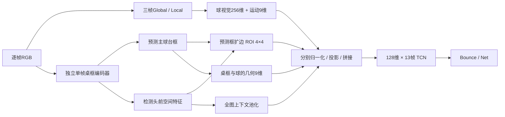

# 球桌训练与视觉特征融合实施计划（2026-11-03）

2026-11-04最新决定：B共享分支继续现有训练，YOLO排队任务取消；独立分支采用原生单帧特征提取＋轻量CNN，从头接受桌框监督。当前实现与配置以[训练说明](table_visual_training.md)为准；下文YOLO选择与预训练比较保留为历史设计依据，不再执行。

目标：在已完成的球定位训练之后，训练**独立单帧球桌视觉分支**，交付预测桌框、保留空间布局的桌面描述符及可靠性信息，为冻结前端的事件头训练准备统一输入。随后以简单拼接建立基线，再验证门控融合；少量端到端微调放在冻结方案验证之后。

本文保留2026-11-03的设计依据。2026-11-04已实现独立YOLO11s与新增的B空间特征复用路线、冻结融合与缓存接口，并按用户要求启动两条球桌训练；见[当前运行及使用说明](table_visual_training.md)。端到端FT与完整部署验收仍是后续阶段。数据与模型的历史身份见[证据快照](table_visual_fusion_plan_20261103_evidence.json)，新实验使用独立目录。

## 1. 已具备的条件与剩余依赖

| 项目 | 已核实情况 | 对本轮的影响 |
| --- | --- | --- |
| 球定位训练 | A/B各自Global、Local均完成20轮；任务JSON仍为`evaluating`，尚无最终A/B总报告 | 桌框训练可立即推进；正式事件缓存待前端评估收尾、配置锁定后生成 |
| 选中权重的PP验证 | A Global F1@50px=87.57%，Local F1@10px=87.38%；B为90.98%/90.46% | B列为精度候选，A保留速度对照；两种容差的数字不能直接横比，也不是最终连续关联评分 |
| 球视觉接口 | A/B真实PP、event25窗口均通过`[1,13,256]`前向与Global/Local非零梯度检查 | 沿用Global128+Local128；接口相容不代表旧事件权重适用，事件头需要重训 |
| 独立桌框标签 | `pp_table_reannotated_v1`已发布，划分保持114/40视频 | 直接采用v1；按此前决定暂缓零星标签精修 |
| 旧桌框实现 | 冻结球Global空间图→4×4池化→MLP回归；历史训练/验证IoU为72.21%/38.75% | 保留作定位对照；38.75%来自旧标签，须在v1重评后才可和新分支比较 |
| 事件模型 | 已验证参考是规则关联、桌框几何、时间编码、13帧TCN | 延续该时序与评价协议，不同时扩窗或更换大模型 |

球定位任务入口为[task.json](../out/experiments/20261103-140723_mixed_ball_comparison/task.json)。正式事件输入需锁定Global/Local配套SHA、各自阈值、关联与回退策略，不能只更换checkpoint路径而继承旧统一阈值。新分支不得据public结果选权重、调阈值或选择A/B。

[已有public规则回放](public_locator_heuristic_20261103.md)显示，新球点直接接旧启发式未转化为落点收益，且存在“有正确球点但未发出事件”。这支持继续准备可学习的事件判别；不据此宣称新事件头已有收益，也不围绕public错误调配方。

## 2. 对照之前框选，固定监督口径

本次重新查看了[六帧新旧框对照](../out/results/20261103_table_reannotated_v1/before_after.jpg)及[14_002相邻帧](../out/results/20261103_train_table_audit/pairs/14_002.jpg)。监督对象保持**主比赛球台的台面及薄桌沿的轴对齐外包框**：排除桌腿、底座、球网与网柱；人物遮挡时不随可见碎片收缩整个球台。

| v1集合 | 视频 | 全部帧 | 有效框 | unknown | 薄框（高度/图高<6%） |
| --- | ---: | ---: | ---: | ---: | ---: |
| train | 114 | 17,398 | 17,281 | 117 | 480，2.78% |
| val | 40 | 6,292 | 5,101 | 1,191 | 629，12.33% |

薄框数由本次直接扫描v1标签得出。历史报告的验证623帧属于原标签；04_004六帧由地板误框改为薄桌框后，v1为629帧。薄框仍显著欠覆盖，不能靠延长普通近重复帧训练解决。

- v1修订仅在val：04_004第115–120帧统一修为`[310,286,862,325]`；不增加训练正例，六帧仍只用于验证。该修订由图像目视完成，尚无独立人工复审。
- 14_002第56–57帧边界与13组零星缺标继续保留在[问题清单](train_table_audit_20261103.md)，本轮不扩展重标范围、不额外删除样本。unknown不转无桌负例、不插值补GT。
- 桌框训练只用17,281个有效训练框；完整val逐帧推理，但IoU只在5,101个有效GT帧评分。unknown帧有预测不能凭缺标判FP。
- bbox四角不是实际桌面四角；本轮不做单应标定，不将框内像素全部视为桌面，也不硬性要求空中球位于框内。
- 监督框保持薄框原定义。为视觉特征扩大ROI属于输入采样策略，不能反过来扩大训练GT。

数据身份：`b0e8814616abec0fb69523d4711a2872172e219b2434db49028a7bb12e1377ee`。沿用源场景隔离，不借入PP public、OpenTTGames game_5或test作桌框训练。

## 3. 球桌分支：先完成一个可用的独立空间编码器

首轮沿用既有计划中的**YOLO11s预训练、单类主比赛球台、单帧RGB、长边640**候选。选择依据是仓库既有工具链与空间特征需求，尚无本数据上的新模型结果。保留检测头前的空间特征，不另训练一个只输出四坐标的MLP。

准备阶段已下载`yolo11s.pt`并记录来源与SHA；使用隔离依赖`ultralytics==8.3.225`，实际空间输出为第16层、128通道、stride8。B共享路线使用冻结B Global的32通道半分辨率空间图，新增中心热图与密集bbox头；两者独立登记，不混称同一个模型消融。

| 项目 | 首轮建议配置 | 必须交付的证据 |
| --- | --- | --- |
| 训练范围 | 桌框监督更新独立编码器及检测头；球Global/Local保持现有权重 | 参数分组、参数更新、球权重SHA不变 |
| 输入与增强 | 640 letterbox；翻转0.5、平移±5%、缩放0.9–1.1；首轮关闭Mosaic/MixUp、垂直翻转、强透视 | 原图→输入→原图坐标往返、增强后bbox叠图；显式覆盖框架默认增强 |
| 采样 | 每轮约4000有效帧；场景组/视频分配，时间桶轮换；薄框采样权重最多3倍 | 每轮样本清单/hash、各组与薄框曝光、累计唯一帧覆盖；不是永久只留4000张 |
| 优化 | AdamW；预训练编码器/neck lr=1e-4，检测头lr=1e-3，weight decay=1e-4；warmup3轮、余弦衰减 | 自定义参数分组与实际lr日志；不能以框架自动优化器冒充该配方 |
| 规模 | seed42；最多80轮，patience12；effective batch16，micro从4起实测，AMP | 含取数、反向、累积与验证的吞吐/显存；不沿用球定位batch测速 |
| 损失 | 选定实现的检测框/分类/分布回归损失，先固定默认权重 | 保存实际权重与各项损失；首轮不叠加新的薄框专用损失 |
| 验证选型 | 每轮完整40视频；按有GT帧计算**视频均IoU**选best，缺预测帧IoU=0 | 帧均、视频均、三视角、逐组、薄框、漏检与错误索引 |
| 选主球台 | 首版无时序：合法候选NMS后按score选top1，平分时固定面积/坐标次序；conf=0.10、NMS IoU=0.70作为首轮固定起点 | 规则只读取预测；同时保留原始候选，复核背景球台误选；不按GT挑框 |

本轮先不做低频更新、EMA框平滑或整段固定框。它们与逐帧独立检测分别评估，避免把时序稳定性和单帧定位精度混在一起。若框已明显改善而薄框边缘仍差，再单独比较640→960；不同时扩大骨干和改变采样。

开始完整训练前，用32–64个已核对的训练帧做过拟合和恢复检查，覆盖三视角、薄框和遮挡；看预测叠图及损失是否正确学习，而不只看loss下降。重评旧头时使用其原配套Global权重和同版v1标签；旧头绑定旧Global SHA，不能移接A/B冒充同一个基线。

桌框验收需要：

1. 与同标签旧头比较帧均/视频均IoU、IoU≥0.5/0.75比例；漏预测不从分母剔除。
2. 分三视角、源组、逐视频及薄框报告；上下边原图像素误差与按GT高度归一化误差另报中位数/P90，并列成功预测覆盖率。
3. 通过逐帧叠图区分边界偏移、遮挡、无输出和选错背景球台；unknown帧只展示预测，不伪造准确率。
4. 连续视频检查切镜头、抖动和恢复，测单分支及接入后耗时。平均IoU约0.70仍是参考目标；能否进入事件实验依据同版改善、分层错误与接口完整性共同决定，不承诺数值收益。

## 4. 桌框辅助监督如何变成事件视觉输入

桌框训练以bbox任务监督空间编码器；事件训练读取该编码器**投影前的空间描述符**。桌框IoU改善不保证特征一定能帮助触台，后续需用视觉分支消融检验。

### 4.1 首版ROI与空间特征

- 先只取检测头前最高空间分辨率的stride8特征图。具体节点和实际通道数`C_T`由模型dry-run确认并写入配置，不在实现前假定通道数，不混用训练态/导出态hook。
- 封装显式返回检测输出和空间图的接口，冻结提取与在线FT共用；只调用最终bbox预测接口不足以取得可求导描述符。后续导出也须保留该空间输出，核对PyTorch/ONNX的图像变换、框与特征，而非只验检测框。
- 预测bbox在原图坐标下扩为`w_roi=1.10*w_box`、`h_roi=max(1.50*h_box,0.08*H)`，保持中心并裁到图内；这些是待验证的首轮起点。保留原始框与扩边框，处理薄框周边上下文。
- 由同一letterbox元数据映射到特征图，显式固定stride、padding、ROI采样对齐与边界规则，得到`[C_T,4,4]`，按固定空间次序展平；另对同一特征图做全图池化得`[C_T]`。不先把ROI整体平均成一个空间无关向量。
- 直接保留原生通道；不新增随机初始化后立即冻结的1×1投影。事件侧的降维层在冻结事件训练中学习。
- 无有效框时ROI描述符置零并置`roi_valid=false`；有效图像的全图上下文仍可保留。框缺失与图像缺失分别处理，桌框失败不抹掉球视觉、运动或整帧事件概率。
- 首轮桌框与桌面视觉均逐帧提取，`age_sec=0`；不在同镜头把整条视觉序列平均。以后若复用历史框，必须记录年龄、失效与切镜头重置策略，重新生成cache_id。

### 4.2 原始接口与缺失约定

新增结构化桌面输入，保留旧球视觉接口，避免将所有量无说明地塞入原256维向量：

| 字段 | 13帧批输入shape/单位 | 约定 |
| --- | --- | --- |
| `ball_visual` | `[B,13,256]` | Global128+Local128；Local有效性仍单列 |
| `motion9` | `[B,13,9]` | 延续坐标、速度、置信度、球/速度/Local有效性、真实相对时间 |
| `table_roi` | `[B,13,16*C_T]` | 预测ROI的4×4空间描述符；独立`roi_valid` |
| `table_context` | `[B,13,C_T]` | 单帧全图上下文；受图像有效性约束 |
| `table_box_xyxy` | `[B,13,4]`，原图px | 未扩边的预测桌框；另存`table_valid` |
| `table_score` / `age_sec` | 各`[B,13]` | 检测分数不是校准IoU；首轮年龄为0 |
| `scene9` | `[B,13,9]` | 沿用cx/cy/w/h、球相对xy、桌框/关系有效性、年龄的字段次序 |
| 索引与mask | 原视频/帧号、源帧号、PTS、图像/球/速度/Local/ROI有效性 | padding、无球、无桌框分别表示；无效值先清理再参与归一化 |

`scene9`中的关系坐标首轮按`max(w_box,0.01W)`、`max(h_box,0.02H)`作分母，并截断到±4，防止薄框放大误差；记录截断比例。这是新的几何版本，G0及其后对照全部一致。缺球则只屏蔽关系项，仍保留有效桌框几何。不跨缺失、重捕获跳变或切镜头计算速度；需检查现有组窗路径是否满足，不能只凭已有速度mask认定已完成。

首版融合维度：球视觉256→96，运动9→32，几何9→32，桌面ROI→48与全图上下文→16，合计224→128，再进入原TCN。各视觉来源分别LayerNorm和投影，投影后再次应用对应mask，避免bias把无效分支变成有效信号。TCN、真实PTS编码、中心读出和Bounce/Net输出沿用参考配置。

## 5. 冻结缓存与在线路径必须先对齐

Global、Local、桌框编码器三者锁定后，以预测球轨迹及预测桌框生成新缓存；不沿用旧桌框MLP缓存，不从GT事件时刻或GT框填入输入。球权重变化后，即使shape仍为256，旧描述符也不能复用。

1. 按视频时间顺序运行关联；PP验证覆盖40视频全部6292帧，保留边界和unknown帧。OpenTTGames仍用event25_v3与原game_1–4/game_5/test隔离；稀疏窗口上下文按真实原帧/PTS解码，未知监督保持mask。
2. 同一前端下的几何/视觉消融复用同一份预测记录。`scene9`等派生字段有独立版本；不要因事件侧投影变化重跑编码器。
3. manifest绑定数据/标签/划分hash、三个前端权重SHA、图像变换、Global/Local类型及阈值、关联与回退、桌框选框/ROI/采样规则、特征层/C_T/shape/dtype、代码hash、原帧与PTS。
4. 缓存按唯一视频帧保存，在组窗时引用，避免把同一描述符重复写13次。FP16作为候选存储格式，先对FP32在线值验证误差与事件logits；未验证前不默认无损。仅桌面特征预算为`N*17*C_T*每元素字节数`，另加球特征、索引与记录。
5. 在三视角、薄框、遮挡、无桌框、无Local、切镜头和首尾窗口抽查在线/缓存逐帧一致性；全无效输入不得产生NaN。对照bbox、ROI坐标、描述符、mask、事件logits和最终事件列表，预登记容差并保存误差。

首轮不增加未来等待：事件窗仍为中心±6原生帧，球定位自身再±1帧。25FPS时最长图像前瞻为7帧约280ms；其他视频按真实PTS报告。单帧桌框不新增前瞻。吞吐和这段等待分别统计。

## 6. 为事件头准备的最小对照

| 顺序 | 配置 | 要回答的问题 |
| --- | --- | --- |
| R | 保留旧三种子TCN+旧球定位+旧桌框参考结果 | 整体系统更新后是否优于既有方案；不是单因素消融 |
| F0 | 锁定的新球前端+原时间编码TCN；不输入桌框几何/视觉 | 新球前端下的事件基线 |
| G0 | F0+独立分支的预测桌框几何 | 独立桌框几何是否有用 |
| V0 | G0+ROI与上下文视觉，简单拼接；保持原TCN/读出/监督 | 空间视觉是否提供几何之外的信息 |
| V0-zero | 与V0相同结构、维度和mask，桌面视觉描述符置零后重新训练 | V0收益是否主要来自新增网络容量；不只在推理时突置零 |
| V1 | 相同输入与输出维度，仅替换为场景条件门控/残差调制 | 门控是否优于简单拼接；报告参数量与耗时差异 |

V1保留球动态路径，调制从接近恒等映射初始化；桌面ROI失效时不把最终事件概率乘零。先seed42顺序筛选，不同时改变运动特征、PP软目标、采样比例或读出。先以G0/V0判断视觉价值，再决定是否值得做V1；无收益可回退。

冻结训练延续PP/TTGames各50%的采样协议、13原生帧、真实PTS、原硬GT评价、原帧±1/原图50px/一对一匹配及三视角宏F1。建议AdamW lr=3e-4、dropout0.1、effective batch8、最多40轮、patience8；实际参数需写入新配置，不能假定旧配置已生效。每轮对完整40视频缓存运行事件头与连续后处理，不只评分稀疏锚点。

对入围候选和对应基线补配对seed43/44，共用每轮采样清单与阈值候选集合；各配置只在内部val按同一规则选阈值，比较三视角P/R/F1、TP/FP/FN、逐视频差值与新增错误。重新分解无球、错球、有球无事件、时间偏移及后处理抑制；旧前端的38/45 FN诊断不能直接沿用。public与TT test留给配置锁定后的外测，不参与本轮筛选。

明确前后状态读出、窄PP软目标及额外运动质量特征仍是后续独立消融；本轮先不合并进去。冻结版有效后，再用原训练集的固定小子集做2–5轮在线FT，保留球定位和桌框辅助损失。事件梯度必须能传回桌框空间特征与球编码器；硬选框/ROI坐标可以detach，ROI采样到的特征不能detach。TTGames无桌框GT时Table loss保持mask。

## 7. 实施拆分、排期依赖与事件头开训条件

以下模块及冻结融合配方已写入；训练成绩、完整一致性验收和未来FT尚待完成。

| 工作包 | 拟实施位置 | 交付与依赖 |
| --- | --- | --- |
| P0 数据入口 | 新增`ttnet/src/data_tools/prepare_table.py`；复用`scene.table.annotation_identity` | 只读v1、unknown排除、视频/场景/时间/薄框采样索引；旧头同版重评 |
| P1 独立训练 | 新增`ttnet/src/models/table_encoder.py`、`ttnet/src/scene/train_visual.py` | 显式参数分组与采样、空间输出、best/last/optimizer/scaler/RNG恢复、完整40视频指标与叠图 |
| P2 特征契约 | 扩展`events/engine.py`、`events/data.py`；新增`scene/visual_cache.py` | 表中结构化输入、连续预测、版本化缓存、在线一致性；同时核对批量提取路径 |
| P3 事件消费端 | 扩展`models/event.py`、`models/build.py`和配置校验/加载 | F0/G0/V0/V0-zero/V1可选；缺失mask、冻结与未来FT路径正确 |
| P4 配方与登记 | 新增独立桌框及融合实验配置；登记到`experiments/records/` | 已解析实际config、依赖SHA、数据版本、采样hash、评价及错误产物 |

特别注意：`scene.train --table-dataset`仍训练旧冻结特征MLP；`scene/cache.py`仍为旧框增补工具；`ContextEventHead`当前只接球视觉256+运动/几何18维，尚无桌面视觉入口。用户打开的`event_comparison_C.json`是旧fixed3+independent+Transformer实验，不能直接当新融合配方。新事件配置应从`event_tcn_reference.json`的协议派生，显式清除旧`table_checkpoint`并更新新前端依赖。

已统一批量、逐帧与关联路径的两路定位阈值，并将阈值、桌面前端、ROI和几何版本纳入缓存身份及组窗签名。完整训练后的在线/缓存一致性仍需后续验收，不能仅凭接口代码完成作出结论。

已有球描述符梯度检查仅覆盖球Global/Local，不能作为新桌框梯度验收。实施时至少验证：冻结阶段只更新事件投影/融合/TCN；在线FT阶段三个编码器的事件梯度有限且非零，桌框辅助监督独立有效；缺失mask、坐标往返、缓存身份拒绝及断点恢复行为正确。

桌框P0/P1可在球定位最终评估收尾期间实施；同GPU作业排队，准确推理测速时独占GPU。P2的正式全量缓存依赖球前端与桌框权重锁定，P3正式训练依赖P2验收。保持有界内存、原视频按需解码和小型特征缓存，不重新展开全量RGB；当前100GB服务器方案继续有效。总时长先测真实路径100个micro step与一次完整验证，再按步数、验证、缓存和导出估算，不复用旧4090预算。

事件头正式开训前检查：

- [ ] 球定位训练结果与最终评估分开登记；选定配套Global/Local SHA、阈值及关联，保留A/B回退。
- [ ] 桌框模型完成v1全val评估、分层指标与错误叠图；旧头同标签结果可比，选框只读预测。
- [ ] 空间特征层、`C_T`、4×4布局、ROI扩边与缺失约定锁定；三视角及TTGames迁移输入抽查完成。
- [ ] 新缓存身份完整，在线/缓存及批量/逐帧路径核对通过，首尾、切镜头和unknown处理无泄漏。
- [ ] F0/G0/V0及容量控制配置可解析，冻结更新范围、采样、完整40视频评分和未来帧等待已核对。

第一步交付应是**独立桌框模型与可验证的空间特征接口**；有了这些，再启动同一锁定前端下的冻结事件头对照。
